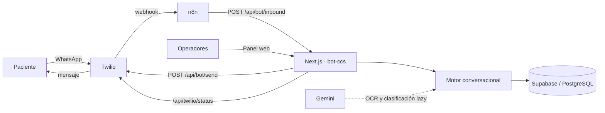

# BOT CCS

Asistente de WhatsApp y panel de operación para **Clínica Cruz del Sur**.

El motor es **determinístico**: las respuestas al paciente se arman desde un catálogo administrable, sin que un modelo de lenguaje redacte texto. Gemini se usa solo como apoyo acotado: OCR de documentos y clasificación de intención "lazy" cuando las reglas determinísticas no resuelven un mensaje.

Estado actual: **Iteración 1 completa y desplegada en producción (Docker)**.

## Contexto y motivación

La clínica atendía consultas por WhatsApp de forma manual: información de especialidades, profesionales, estudios, obras sociales y ubicaciones, más la captura de datos para derivar solicitudes a cada área. Este trabajo era repetitivo y no dejaba registro ni métricas.

BOT CCS resuelve el problema con un asistente que:

- responde consultas frecuentes de forma automática y consistente;
- captura datos (nombre, DNI, cobertura, disponibilidad) y valida documentos;
- deriva los casos a la cuenta de área correcta en el panel;
- permite que los operadores tomen control, respondan y cierren casos;
- expone métricas operativas al administrador.

El beneficio esperado es reducir la carga manual y los casos mal derivados. Los resultados operativos (volumen, resolución, tiempos) se miden en el panel de datos y no se afirman aquí como concluidos.

## Objetivos y alcance

**Objetivo principal:** automatizar la atención inicial por WhatsApp y organizar la derivación de casos a las áreas de la clínica.

**Objetivos secundarios:**

- Registrar conversaciones, casos y mensajes para su seguimiento.
- Administrar el contenido de las respuestas sin tocar código ni reiniciar el servicio.
- Dar a cada área una cuenta con acceso solo a sus conversaciones.

**Incluye:** consultas de especialidades/profesionales/estudios/servicios/obras sociales, captura y validación de DNI, derivación por área, panel de conversaciones, banco de respuestas, usuarios y panel de datos.

**No incluye:** agenda de turnos reales, historia clínica, facturación, descarga de estudios ni visualización segura de adjuntos.

## Funcionalidades principales

Resumen por bloques; el detalle está en [docs/FEATURES.md](docs/FEATURES.md).

- **Atención al paciente:** saludo, clasificación determinística, respuestas por especialidad/profesional/estudio, servicios directos, obras sociales y vCards.
- **Datos y DNI:** captura de nombre, DNI, cobertura y disponibilidad; validación estructurada de frente y dorso (OCR de Gemini, sin persistir los archivos).
- **Áreas y permisos (Iteración 1):** derivación por intent o profesional, permisos por área, estado de resolución, presencia, alta de usuarios y panel de datos.
- **Panel de conversaciones:** filtros, toma de control, respuesta humana, liberación y cierre; control humano con vencimiento.
- **Banco administrable:** edición y publicación de textos, profesionales, estudios y coberturas, con historial, restauración y publicación sin build ni reinicio.

## Arquitectura y funcionamiento

Flujo de principio a fin:



Componentes principales: motor (`src/lib/bot-core.ts`, `bot-catalog.ts`, `bot-engine.ts`), áreas y permisos (`src/lib/areas.ts`), autenticación (`src/lib/auth.ts`), catálogo versionado (`src/lib/managed-catalog.ts`), Supabase, Twilio, n8n y Gemini. Detalle completo en [docs/ARCHITECTURE.md](docs/ARCHITECTURE.md).

## Tecnologías utilizadas

| Tecnología | Función |
|---|---|
| Next.js 16 / React 19 | Interfaz del panel y route handlers server-side. |
| TypeScript | Lenguaje del proyecto. |
| Tailwind CSS 4 | Estilos del panel. |
| Supabase / PostgreSQL | Base de datos, Auth y RLS (operadores, contactos, conversaciones, casos, mensajes, catálogo). |
| Twilio | Recepción y envío de mensajes de WhatsApp, media/vCards y callbacks. |
| n8n | Normaliza el webhook de Twilio y enruta hacia la API local. |
| Gemini | OCR de documentos y clasificación de intención "lazy" (no redacta respuestas). |
| Docker Compose | Ejecución de `web`, `maintenance`, `cloudflared` y `tools`. |
| Cloudflare Tunnel | Publicación del dominio `ccs.aeye.com.ar`. |
| Vitest | Pruebas unitarias, de integración y matriz del bot. |

## Requisitos previos

- Docker Engine con contenedores Linux y Docker Compose. El host no necesita Node ni PM2.
- Proyecto Supabase (externo) con las migraciones aplicadas.
- Instancia n8n existente con el workflow BOT CCS.
- Túnel Cloudflare con token propio para la publicación pública.
- Cuentas de operador (Supabase Auth) con áreas asignadas.

## Instalación y configuración

1. Clonar el repositorio.
2. Crear los archivos privados de entorno fuera de Git (por ejemplo `C:/ProgramData/BotCCS/runtime.env` y `deploy.env`) copiando los nombres de las plantillas:
   - [.env.example](.env.example) — variables de runtime (Supabase, Twilio, Gemini, n8n, retención, vCards).
   - [.env.docker.example](.env.docker.example) — variables de Compose (rutas de archivos privados, puerto, imagen).
3. Completar los valores reales en los archivos privados. `BOT_CCS_WEBHOOK_SECRET` es obligatorio y debe coincidir con la credencial Header Auth de n8n.
4. Publicar el túnel Cloudflare apuntando `ccs.aeye.com.ar` a `http://web:3010`.

Las variables `NEXT_PUBLIC_SUPABASE_URL` y `NEXT_PUBLIC_SUPABASE_ANON_KEY` son públicas por diseño y se usan en el build. El resto se inyecta solo al ejecutar. Detalle y precauciones en [docs/OPERATIONS.md](docs/OPERATIONS.md).

## Cómo ejecutar el proyecto

Producción (Docker Compose, una sola réplica web):

```powershell
docker compose --env-file C:/ProgramData/BotCCS/deploy.env build web maintenance tools
docker compose --env-file C:/ProgramData/BotCCS/deploy.env up -d web maintenance
docker compose --env-file C:/ProgramData/BotCCS/deploy.env --profile public up -d cloudflared
```

Verificar estado:

```powershell
docker compose --env-file C:/ProgramData/BotCCS/deploy.env ps
docker compose --env-file C:/ProgramData/BotCCS/deploy.env logs --tail 100 web maintenance
```

Salud: `/api/health/live` (vida del proceso) y `/api/health/ready` (Supabase y catálogo válido). Detener o reiniciar servicios, publicar el túnel y recuperar ante fallos está en [docs/OPERATIONS.md](docs/OPERATIONS.md).

## Estructura del repositorio

```
bot-ccs/
├── src/
│   ├── app/           # Panel web (App Router) y endpoints de API
│   ├── components/    # Paneles de chat, banco, usuarios y datos
│   └── lib/           # Motor, catálogo, áreas, auth, Supabase, Twilio, vCards
├── supabase/
│   └── migrations/    # Esquema, áreas y reglas de derivación (004–009)
├── scripts/           # Importación, migraciones, mantenimiento y verificación
├── tests/             # Unitarias, integración y matriz del bot
├── n8n/               # Workflow canónico (sin secretos)
├── data/              # Fixtures de importación/pruebas (no productivo)
├── docs/              # Documentación canónica y roadmap
├── compose.yaml       # Servicios: web, maintenance, cloudflared, tools
└── Dockerfile         # Imágenes multietapa (runtime, maintenance, tools)
```

Las dependencias y `.next` se generan dentro de las imágenes; los reportes de pruebas viven en un volumen de Compose. Detalle por carpeta en [docs/ARCHITECTURE.md](docs/ARCHITECTURE.md) (sección "Organización del proyecto").

## Configuración y seguridad

- Los secretos (Supabase service role, Twilio, Gemini, token del túnel) se inyectan desde archivos privados fuera del repositorio; nunca se versionan.
- `.env.local` es una entrada opcional para herramientas y no forma parte de las imágenes.
- RLS habilitado en Supabase; las escrituras privilegiadas usan `service_role` server-side.
- Los paneles administrativos y `/api/admin/*` quedan restringidos a las cuentas de `BOT_CCS_ADMIN_USERS`.
- Los adjuntos se procesan en memoria para validación con Gemini; no se persisten ni se muestran.
- No versionar: secretos, datos de pacientes, logs, backups ni evidencias de pruebas.

## Pruebas y validación

Existen pruebas unitarias, de integración y una matriz generada de escenarios, herméticas (sin Supabase/Twilio/red). Ejecutarlas dentro del servicio `tools`:

```powershell
docker compose --env-file C:/ProgramData/BotCCS/deploy.env --profile tools run --rm -e GEMINI_API_KEY= tools npm test
docker compose --env-file C:/ProgramData/BotCCS/deploy.env --profile tools run --rm tools npm run lint
```

Qué validan, el criterio de alta y la línea base están en [docs/TESTING.md](docs/TESTING.md).

## Limitaciones y problemas conocidos

- No agenda turnos reales, no consulta historia clínica ni facturación, no descarga estudios ni ofrece visualización segura de adjuntos.
- Pendientes operativos: WhatsApp real, reinicio coordinado del host, retiro de la cuenta temporal `admindev` y retirada de la ruta Cloudflare antigua. Ver [docs/OPERATIONS.md](docs/OPERATIONS.md#comprobaciones-pendientes).
- La información de ubicaciones/edificios hoy se sirve como texto fijo; su modelado como dato estructurado está planificado en [docs/ROADMAP.md](docs/ROADMAP.md).

## Documentación relacionada

- [Arquitectura](docs/ARCHITECTURE.md)
- [Funcionalidades](docs/FEATURES.md)
- [Banco de respuestas](docs/CATALOG.md)
- [Operación y despliegue](docs/OPERATIONS.md)
- [Pruebas](docs/TESTING.md)
- [Historial de cambios](docs/CHANGELOG.md)
- [Roadmap (trabajo futuro)](docs/ROADMAP.md)
- [Memoria de continuidad](MEMORY.MD) — lectura obligatoria al iniciar cada sesión.

Cada cambio debe actualizar su documento canónico y `docs/CHANGELOG.md`; el trabajo futuro se registra en `docs/ROADMAP.md`.

## Créditos y licencia

Equipo, responsables y licencia: **pendientes de definir** (no figuran en el repositorio).
